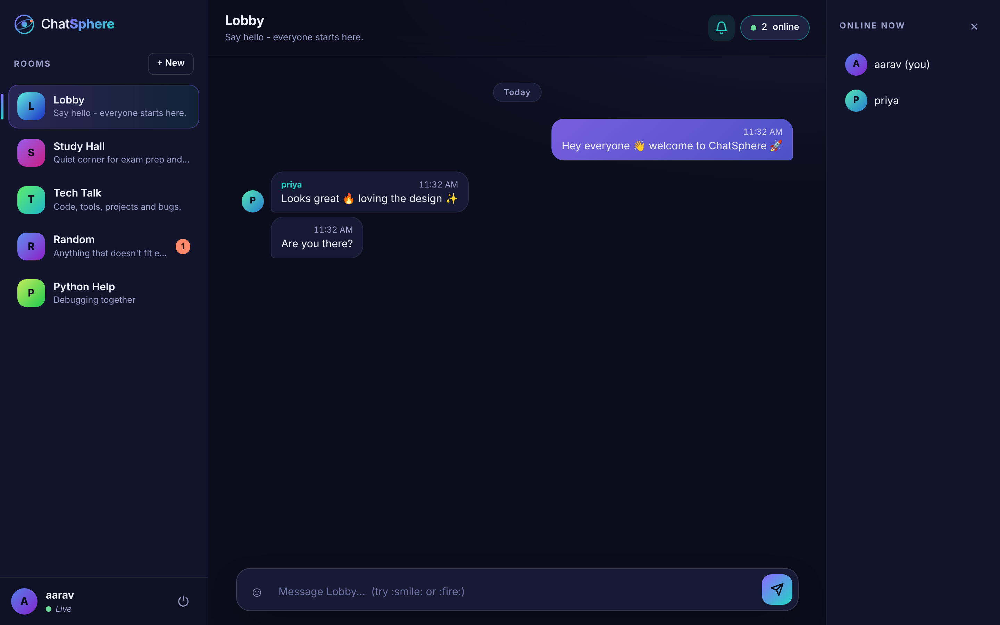
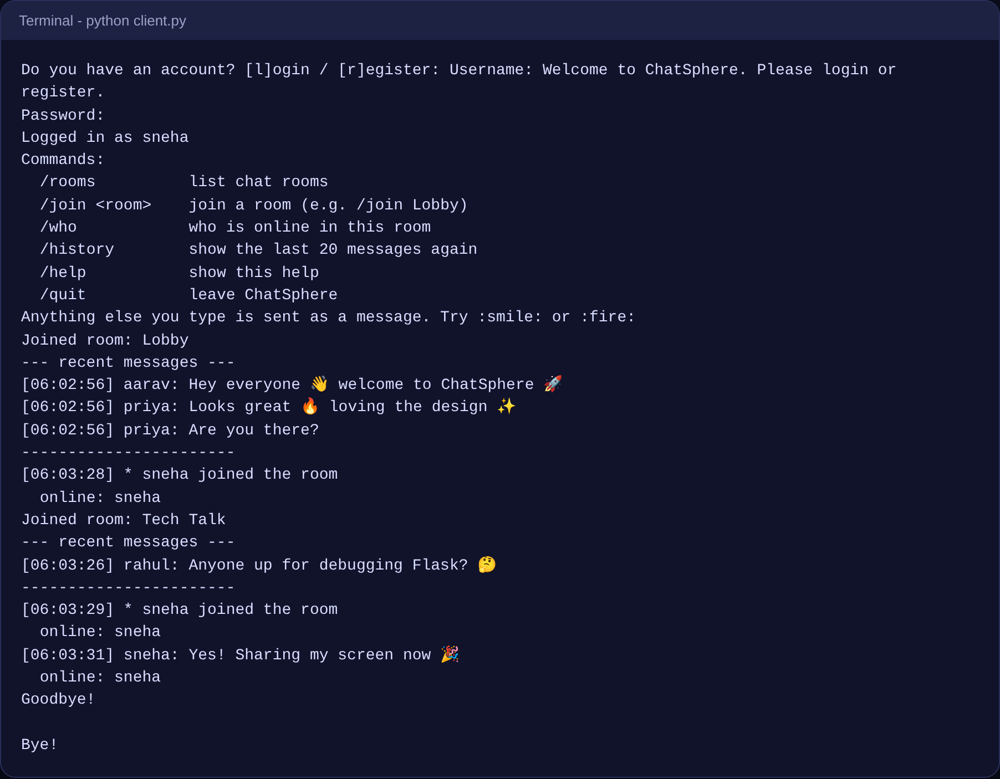

# ChatSphere

A real-time chat platform with a polished web interface and a separate command-line client.
Built for the **Oasis Infobyte Python Programming Internship - Task 5 (Chat Application)**.

Stack: Python, Flask, SQLite3, HTML5/CSS3/JavaScript, raw TCP sockets, pytest.



## Features

| Requirement | How ChatSphere does it |
|---|---|
| Server accepts client connections | `run_server.py` starts the web server (port 5000) and a TCP socket server (port 5001) |
| Client sends / receives messages | Browser UI and `client.py` CLI |
| Real-time two-way communication | Browser: HTTP POST + Server-Sent Events stream. CLI: persistent TCP socket. Both share one in-memory hub, so browser and terminal users see each other instantly |
| Timestamps | Every message is stored with a UTC timestamp and shown in the viewer's local time |
| Graceful disconnects + notifications | Closing a tab or terminal broadcasts "<name> left the room" and updates the online list |
| Localhost | Binds to `127.0.0.1` by default |
| GUI with Flask | Responsive web app (login, register, rooms, chat) |
| Registration and login | Salted password hashes (Werkzeug scrypt), server-side session cookie, CSRF tokens |
| Multiple chat rooms | 4 default rooms, users can create more |
| Message history in SQLite | `users`, `rooms`, `messages` tables; history loads on join, "Load earlier messages" pages further back |
| Notifications when window is not focused | Browser Notification API (permission requested via banner/bell), plus unread badges and a `(n)` count in the tab title |
| Emoji shortcodes | `:smile:` becomes a smiley, converted on the server so web and CLI users get the same result; emoji picker in the UI |

### A note on Socket.IO

The brief lists Flask-SocketIO. The environment this project was built and tested in had no network access for installing packages, so Flask-SocketIO could not be installed or tested. Instead the real-time layer uses standard-library sockets (TCP for the CLI) and Server-Sent Events (for the browser). This still gives real-time two-way communication and needs only Flask, which also makes the Windows setup simpler. See `docs/ARCHITECTURE.md` for details. Message delivery is not end-to-end encrypted: messages are stored in plain text in SQLite and travel over plain HTTP on localhost.

## Install and run on Windows

1. Install **Python 3.9 or newer** from python.org (tick *Add Python to PATH*).
2. Extract `ChatSphere_Complete.zip`.
3. Double-click **`run_windows.bat`**. It creates a virtual environment, installs the packages and opens http://127.0.0.1:5000.

Or manually in Command Prompt / PowerShell inside the `ChatSphere` folder:

```bat
python -m venv venv
venv\Scripts\activate
pip install -r requirements.txt
python run_server.py
```

Open http://127.0.0.1:5000, click **Create an account**, then chat.

### Try it with two users
Open a second browser (or a private window), register another user, and join the same room. Messages appear instantly on both sides.

### CLI client
With the server running, open a new terminal:

```bat
python client.py
```
(or double-click `run_client_windows.bat`). Register or log in, then use:
`/rooms`, `/join <room>`, `/who`, `/history`, `/help`, `/quit`. Anything else is sent as a message.



## Running the tests

```bat
python -m pytest -q
```
36 tests cover registration, login, logout, CSRF, password hashing, rooms, messages, timestamps, emoji conversion, history paging, SSE streaming, the TCP server, CLI client, disconnect notices, and the notification code.

## Configuration

Copy `.env.example` to `.env` to change ports or the secret key. Without a `.env`, ChatSphere generates a random secret key in `instance/secret.key` (never committed). The database is `instance/chatsphere.db`.

## Project layout

```
app.py                Flask app factory
run_server.py         starts web + TCP servers
client.py             command-line client
chatsphere/           auth, chat routes, service rules, database, hub, tcp_server, emoji
templates/ static/    HTML, CSS, JavaScript, logo
tests/                pytest suite
docs/ARCHITECTURE.md  design notes
screenshots/          UI screenshots
```

## Security notes
Passwords are hashed (never stored or logged in plain text), sessions use HttpOnly cookies, forms and API calls require a CSRF token, all SQL is parameterised, and messages are inserted into the page as text (no HTML injection). This is a development server intended for localhost; for real deployment use a production WSGI server (e.g. waitress on Windows) and HTTPS.
